# Super-resolution of cosmological density fields with conditional flow matching

  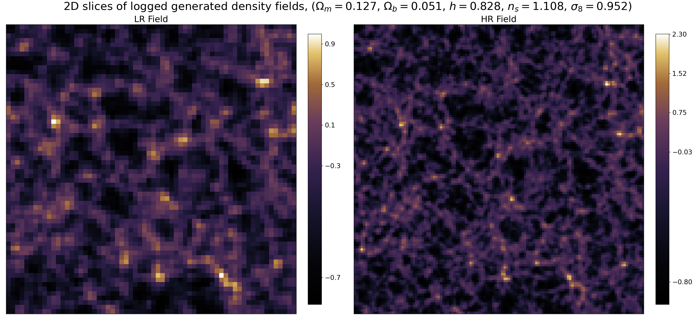

This repo contains the code for my MSc thesis in Physics of Data a the University of Padova, *Super-resolution of cosmological density fields using score-based diffusion models*, supervised by Prof. Nicola Bartolo (UNIPD) and co-supervised by Prof. Michele Liguori (UNIPD). The thesis in full can be found in [`docs/thesis.pdf`](docs/thesis.pdf).

During the traineeship and thesis work I developed a wavelet-based 3D U-Net that is trained through the conditional flow matching framework to learn the velocity field connecting the probability density field of low resolution realisations of grid assigned dark matter density fields. from the Quijote N-body simulations suite, to higher resolution cubes, essentially super resolving the missing scales (0.2 ≲ k ≲ 0.4 h/Mpc) of the LR 64³ grids to generate 128³ cubes compatible with the truth. The network fills the missing frequencies conditioned on both the low-resolution field and on five cosmological parameters different for each simulation (Ωm, Ωb, h, ns, σ8). The LR source is perturbed by noise in the missing band of appropriate power in order to prevent the model from collapsing onto the ensemble average of the velocity field, which would output a realisation too smooth compared to the truth.

  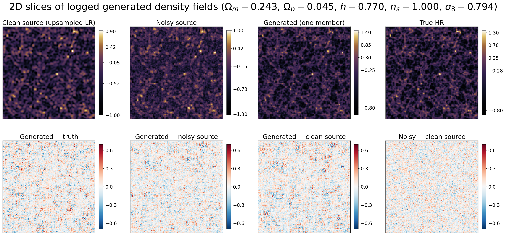

## Results

The results obtained, measured on a held-out test set, with 16 ensemble memebers generated per simulation and 100 Euler steps, are the following:

| Statistic | Generated vs. 128³ target |
|---|---|
| Power spectrum | 2–7 % below the target |
| One-point PDF | within a few percent for −0.8 ≲ δ ≲ 10 |
| Bispectrum, squeezed and angle scans | within about 6 % |
| Bispectrum, equilateral | within about 10 % |

The given scales are left unchanged while the target band is generated with the correct power and phase, showcased by the matching of both the power spectrum and the bispectrum in different configurations. The accuracy is good and shows the viability of the method for the upsampling task, but it is still far from the percent level accuracy needed in precision cosmology.

  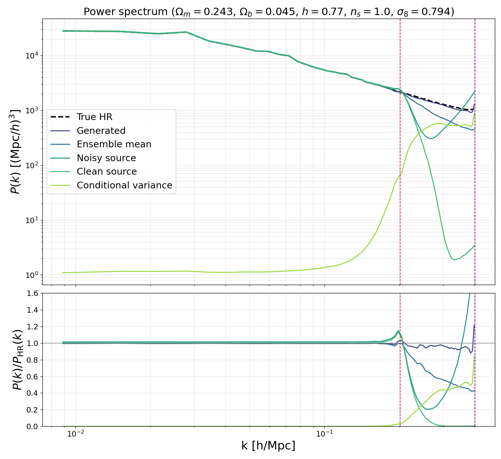

  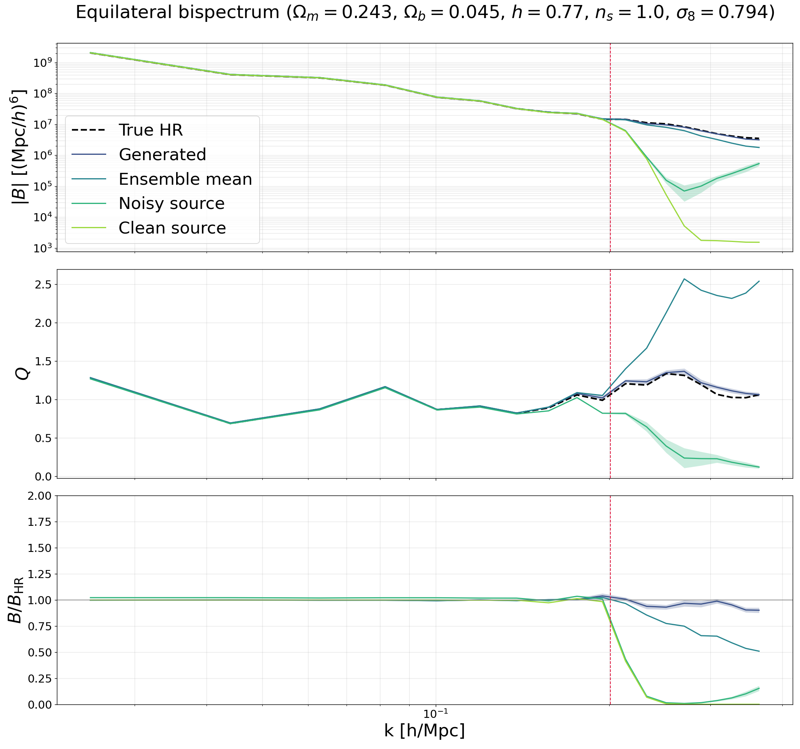
  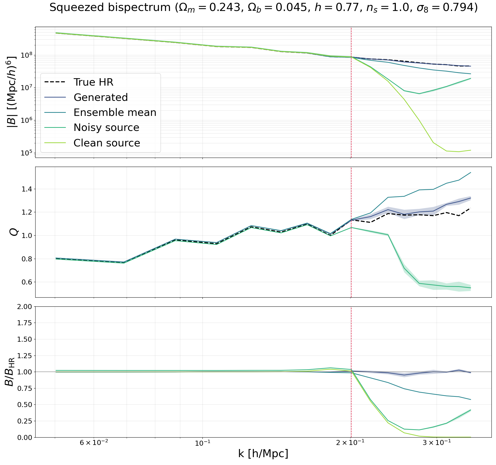

## How it works

1. **Density fields** (`mass_assign.py`): 2000 simulations from the Quijote Latin Hypercube Suite, each consisting of evolved N-body simulations at z=0 (present time), 512³ particles strong, is grid assigned to a 64³ and a 128³ grid with the piecewise cubic spline (PCS) mass assignement scheme.
2. **Source upsampling** (`upsample_lr.py`): Each 64³ field is brought onto the 128³ grid by zero-padding its Fourier modes.

  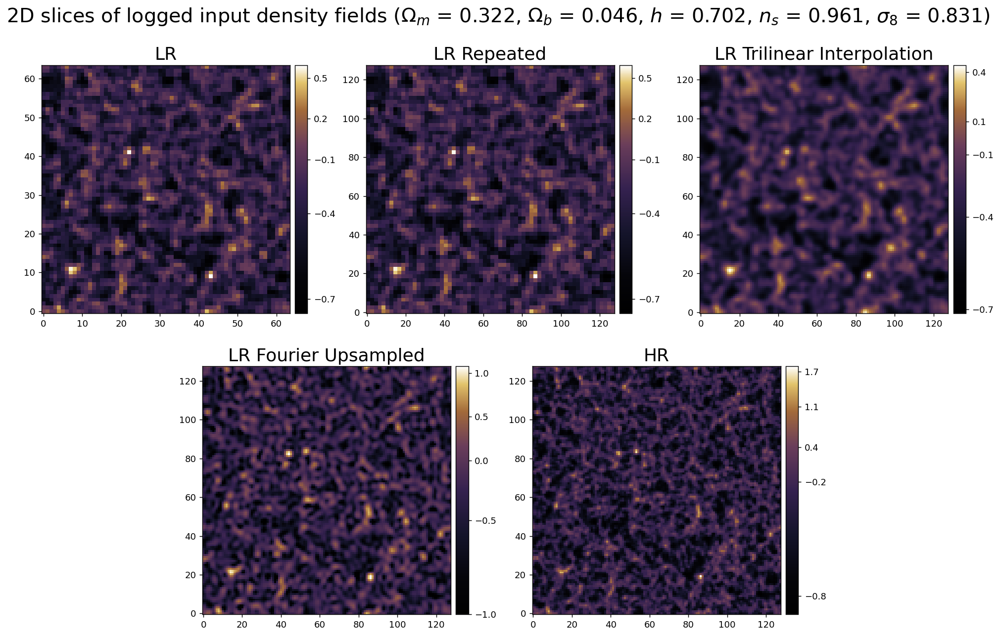
  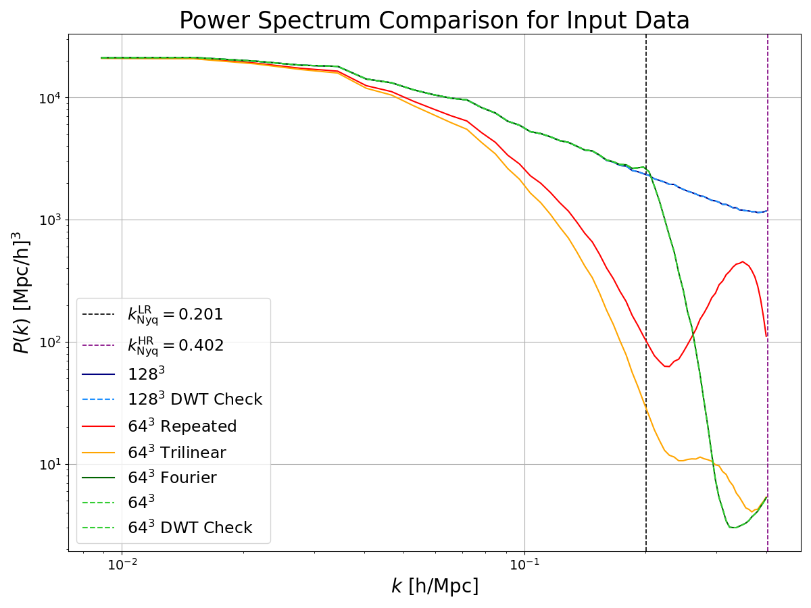

3. **Preprocessing**: We apply a logarithmic transform: δ → ln(δ + 2) − 1, then add the band-limited Gaussian noise, with an amplitude equal to the true high-k power measured on the training set, and finally apply a Haar wavelet transform which turns each 128³ cube into eight 64³ sub-bands, normalised band by band. This helpes both at reducing the number of computations in the convolutional layers of the net and at a mild scale separation we use throughout the net to particularly tackle the small scale generation problem. Such separation is of course not complete given the precise localisation of the wavelet kernel in real space, which corresponds to a wide frequency domain for each band, however it was a tentative approach to study such application given the ease of computing the Haar Wavelets; more frequency localised yet computationally demanding transforms can indeed be implemented.

  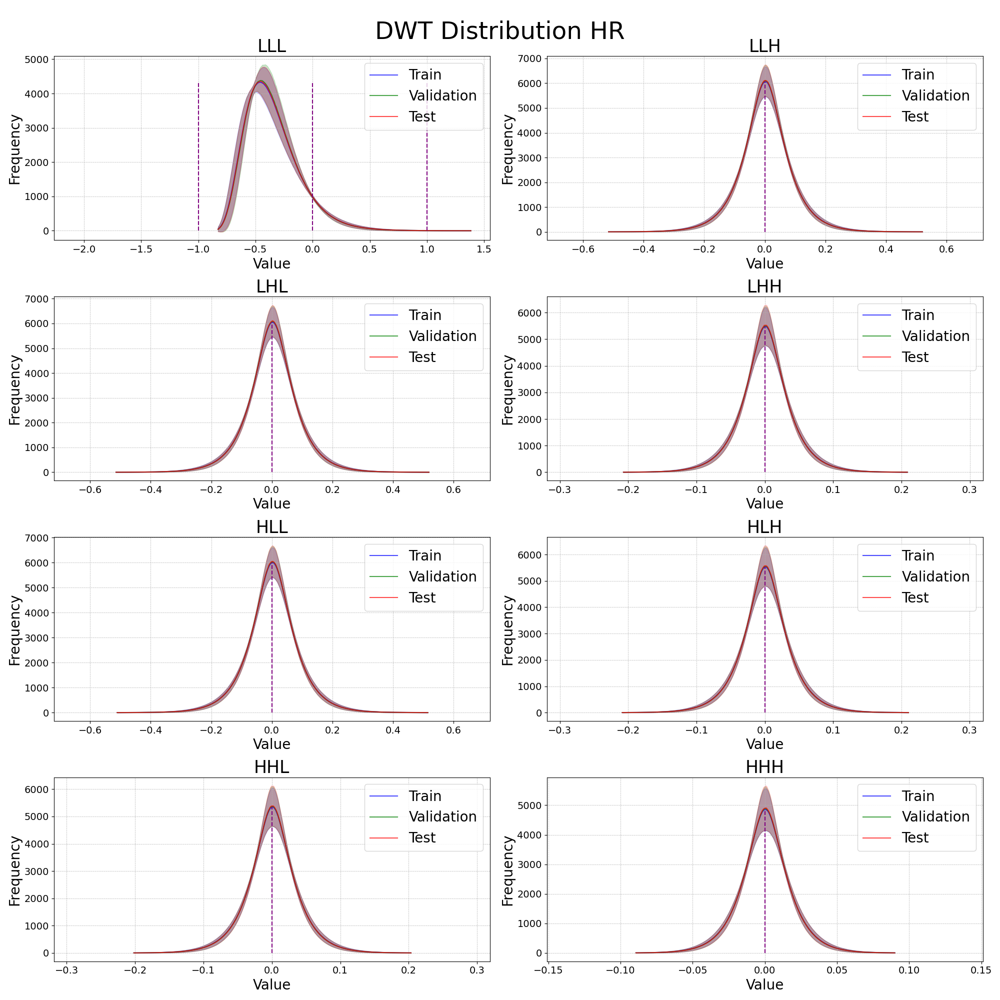
  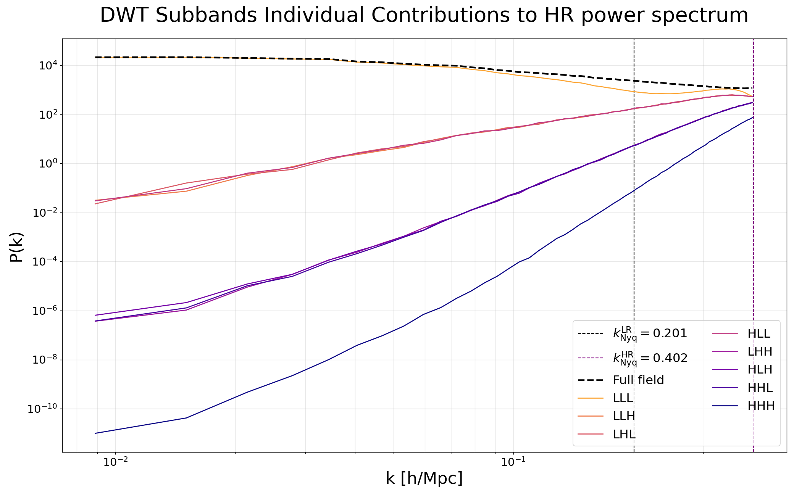

4. **Model** (`model.py`): the model consists in a wide and shallow 3D U-Net (10.9 M parameters) with wavelet-specific convolutional blocks and attention-gated skip connections precisely designed to spot, learn and generate the small missing scales. It is the conditioned throughout its components on the flow time and the cosmological parameters, properly injected through AdaGN.

  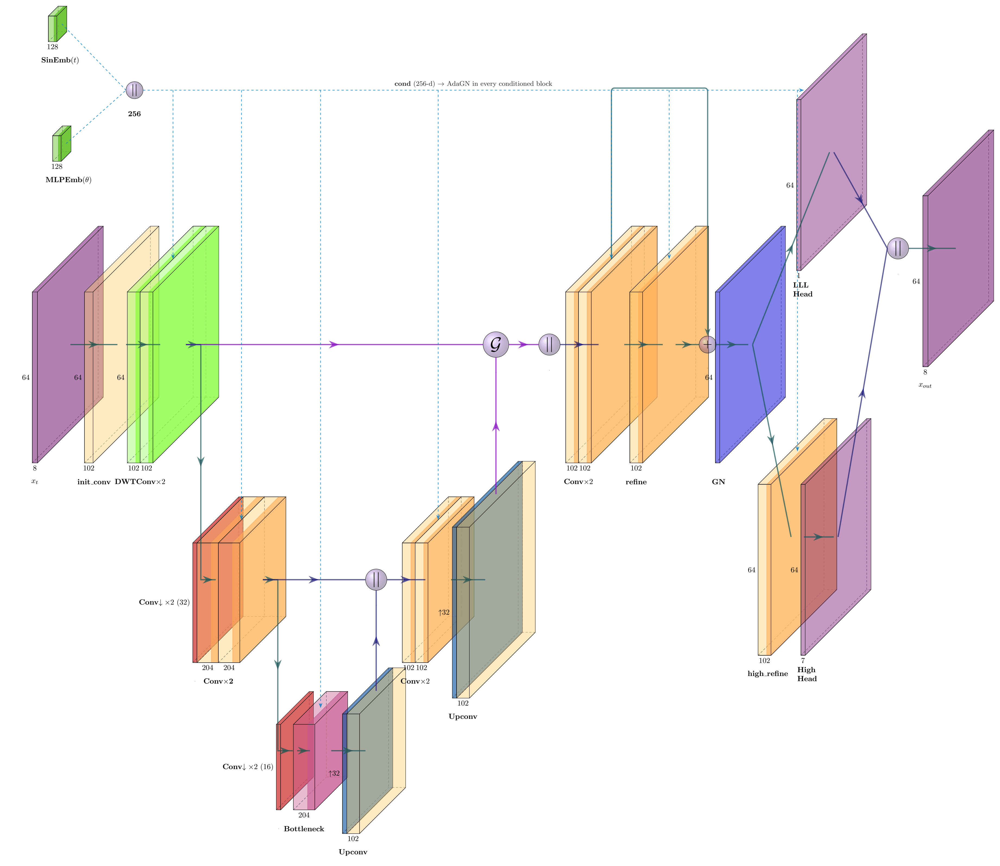

  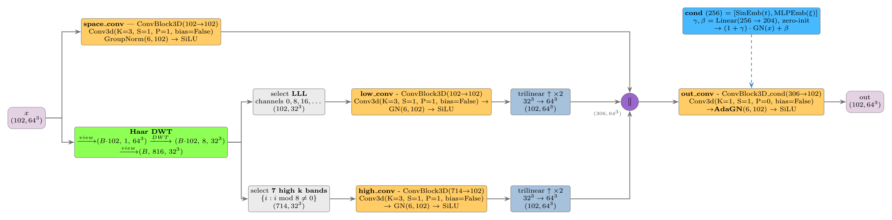

  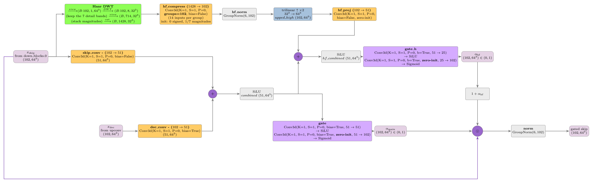

5. **Training**: the model learns the velocity through conditional straigh paths x_t = t·x_HR + (1 − t)·x_LR with an MSE normalised by the variance of each sub-band, to keep the bands' contributions to the loss comparable. The training task in practice is implemented with the AdamW optimiser, linear warmup of the learning rate, mixed precision, an exponential moving average of the weights in validation and inference for more stable realisations of the model, and with a compiled, hardware specific computation graph to speed up the training process. The thesis model was trained for 600 epochs on two NVIDIA T4 GPUs in parallel, for about 96 hours in total.

  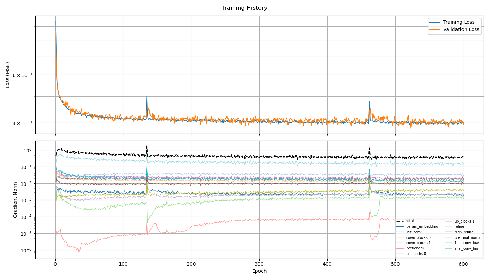

  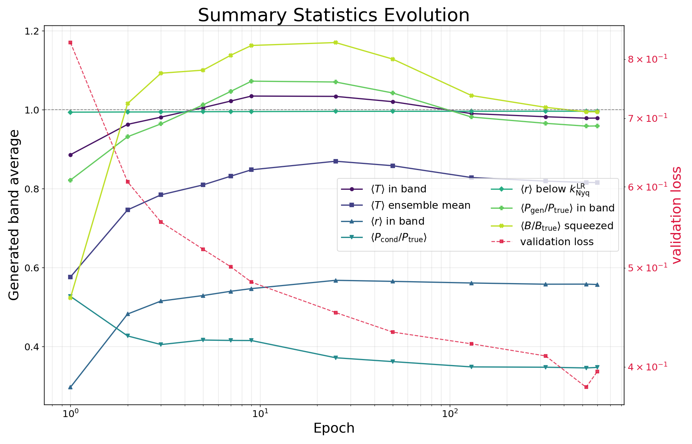

6. **Sampling**: the model's learned velocity induces an ODE we integrate with the explicit Euler method for 100 steps to obtain the high resolution fields from the low resolution perturbed sources, which takes about 73 seconds for the single field on a single T4.

  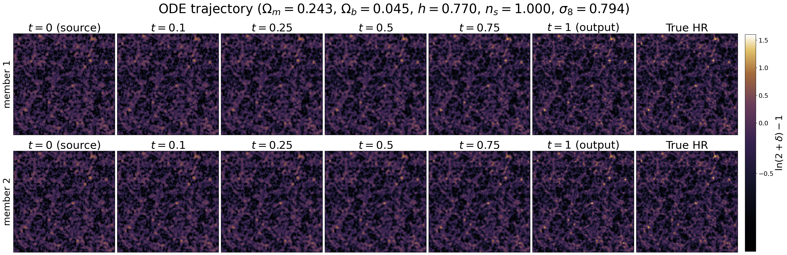

Further considerations, limitations and conclusions are discussed in the thesis.

## Parameters and Flags

| Variable | Default | Meaning |
|---|---|---|
| `EPOCHS` | `100` | epochs to train in this run (`0`: evaluation only) |
| `BATCH_SIZE` | `8` | global batch size, split across the GPUs |
| `NUM_ODE_STEPS` | `100` | Euler steps used for sampling |
| `PARALLEL` | `True` | DistributedDataParallel over all visible GPUs |
| `AMP` | `True` | mixed-precision training |
| `VAL_FLAG` | `True` | evaluation and diagnostics after training |
| `STATS_FLAG` | `True` | compute the split and the normalisation statistics, or reload them from `./param_stats`; with `False` they are read from `PARAM_PATH` |
| `PARAM_PATH` | | saved `param_stats` file, used when `STATS_FLAG=False` |
| `LOG_FLAG` | `True` | log transform of δ (otherwise a plain standardisation) |
| `BASE_PATH_STR` | `data/fields` | folder with the training fields |
| `PARAM_FILE_STR` | `data/latin_hypercube_params.txt` | Quijote parameter file |

## Acknowledgements

Thesis supervised by Prof. Nicola Bartolo and co-supervised by Prof. Michele Liguori. The simulations come from the [Quijote suite](https://quijote-simulations.readthedocs.io/en/latest/LH.html) and the density grids were built with [Pylians](https://github.com/franciscovillaescusa/Pylians3).